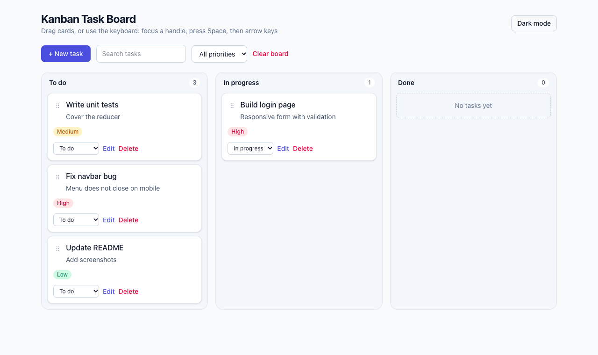

# Kanban Task Board

A drag and drop task board built with React, TypeScript, Tailwind CSS and dnd-kit. Tasks are saved in your browser.



**Live demo:** https://shreybillade3-hub.github.io/kanban-task-board/

## Features

- Three columns (To do, In progress, Done) with drag and drop between and within columns
- **Keyboard accessible**: focus a card's handle, press Space, move with the arrow keys. A "Move to" select on every card is a second non-drag option
- Add and edit tasks in an accessible dialog with title validation, priority and due date. Overdue tasks are highlighted
- Search and priority filters (reordering pauses while filters are active, so the saved order is never confused)
- Board is saved to `localStorage` and restored on reload
- The board starts empty. "Load example tasks" adds clearly labeled sample tasks if you want to try it out
- Light and dark theme, responsive columns

## Tech stack

React 19, TypeScript, Vite, Tailwind CSS v4, dnd-kit, Vitest, React Testing Library, GitHub Actions

## Project structure

```
src/
  components/  Column, TaskCard, TaskForm, ThemeToggle
  hooks/       useBoard (reducer + persistence), useTheme, useLocalStorage
  lib/         board (pure operations, filters), reducer
```

All board logic (`addTask`, `moveTask`, `updateTask`, filters, overdue checks) lives in `src/lib/board.ts` as pure, immutable functions. The UI only dispatches actions to a reducer, so the logic is easy to test.

## Getting started

```bash
npm install
npm run dev
npm test
npm run lint
npm run build
```

## Testing

Unit tests cover moving tasks within and between columns, no-op moves, immutability, filters and overdue logic. Integration tests cover adding, validating, editing, deleting, filtering, moving with the accessible select, and persistence across reloads.
